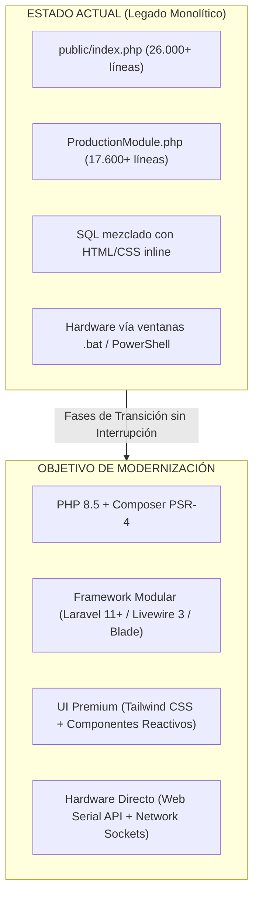
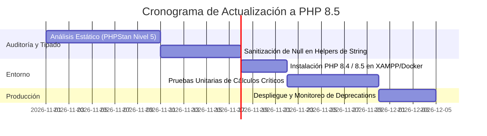
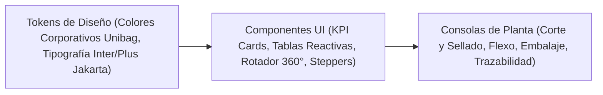
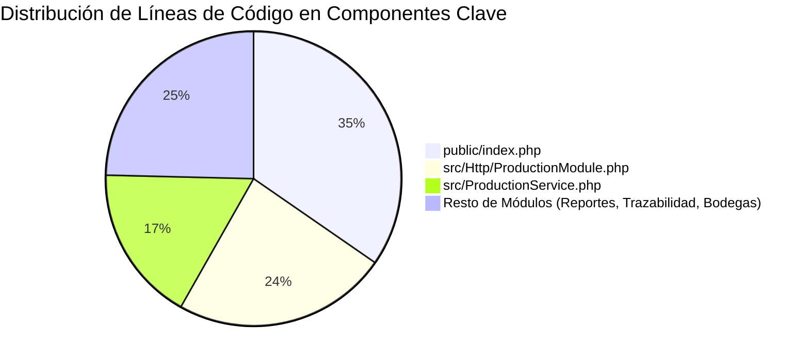
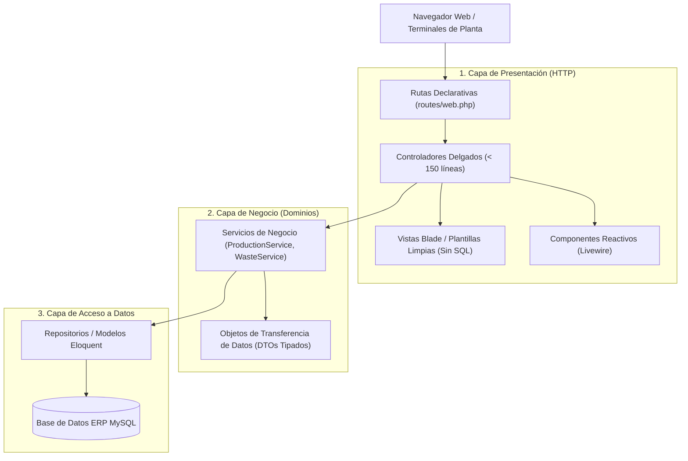
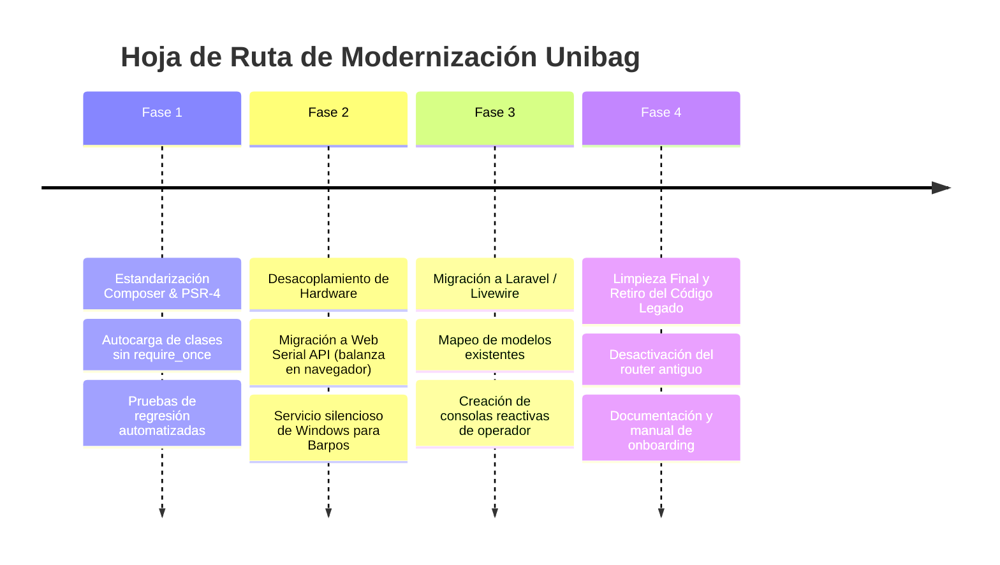

# PLAN MAESTRO DE MODERNIZACIÓN Y ARQUITECTURA TÉCNICA · UNIBAG ERP

> **Documento Estratégico de Ingeniería de Software**  
> **Fecha:** Octubre 2026  
> **Objetivo:** Actualización a PHP 8.5, evaluación de framework (Laravel), modernización de hardware industrial (impresoras y balanzas sin consolas intermedias), y reestructuración integral de la arquitectura para máxima mantenibilidad y estética visual.

---



---

# PARTE 1: PLAN DE MODERNIZACIÓN TECNOLÓGICA & HARDWARE

---

## 1. Actualización de Versión de PHP (Transición hacia PHP 8.4 / 8.5)

### 1.1. Diagnóstico de la Versión Actual
Actualmente el proyecto corre sobre **PHP 8.0.30 (XAMPP en Windows)**. Aunque PHP 8.0 introdujo mejoras clave (JIT, tipos de unión, match), ya ha alcanzado el fin de su ciclo de vida oficial (EOL). 

### 1.2. Novedades y Rompimientos Clave (Breaking Changes) hacia PHP 8.4 y 8.5

| Versión | Cambio Crítico / Característica | Impacto en el Código Unibag Actual |
| :--- | :--- | :--- |
| **PHP 8.1** | Tipos de retorno `never`, propiedades `readonly`, Enums, deprecación de pasar `null` a funciones internas (ej. `strlen(null)`, `htmlspecialchars(null)`). | **ALTO**. En el código actual hay cientos de llamadas `htmlspecialchars($row['campo'])` donde `$campo` puede ser `null`. En 8.1+ genera `Deprecated`, y en 8.4+ genera errores fatales si no se castea a `(string)`. |
| **PHP 8.2** | Deprecación de propiedades dinámicas en clases (`stdClass` o clases no declaradas). | **MEDIO**. Afecta a modelos y DTOs antiguos donde se asignaban propiedades al vuelo sin declararlas en la clase. |
| **PHP 8.3** | Tipado de constantes de clase, función `json_validate()`, excepciones de desbordamiento en enteros de fecha. | **BAJO**. Beneficia la validación de payloads JSON en eventos de producción. |
| **PHP 8.4** | **Property Hooks** (getters/setters nativos en propiedades), **Asymmetric Visibility** (`public private(set)`), deprecación definitiva de nulabilidad implícita en parámetros `function test(string $x = null)` $\rightarrow$ debe ser `?string $x = null`. | **MEDIO-ALTO**. Requiere tipado estricto en signaturas de métodos de `ProductionService` y módulos HTTP. |
| **PHP 8.5** | Optimizaciones JIT de última generación, mayor inferencia de tipos estáticos, consolidación de Fiber para I/O asíncrono. | **ALTO RENDIMIENTO**. Permite operaciones concurrentes ultra-rápidas para reportes y telemetría de máquinas. |

### 1.3. Plan Paso a Paso para la Actualización a PHP 8.5



1. **Paso 1: Auditoría de Análisis Estático con PHPStan**:
   - Instalar PHPStan en nivel 2, escalando a nivel 5.
   - Detectar todos los puntos donde se pasan valores potencialmente `null` a funciones nativas (`strlen`, `substr`, `preg_match`, `htmlspecialchars`).
2. **Paso 2: Corrección de Signaturas Nulables**:
   - Reemplazar parámetros implícitos como `function query($filter = null)` por `function query(?string $filter = null)`.
3. **Paso 3: Tipado Fuerte de Propiedades**:
   - Declarar todas las propiedades de servicios (`ProductionService`, `TraceabilityService`) con sus tipos nativos (`protected PDO $erpPdo;`).
4. **Paso 4: Actualización del Runtime en Windows**:
   - Descargar e instalar el binario x64 Thread Safe (o Non-Thread Safe para FastCGI) de PHP 8.4/8.5 para Windows.
   - Configurar `php.ini` activando `opcache.jit=tracing` y `opcache.jit_buffer_size=128M` para un boost de velocidad del 30-40% en cálculos de mermas y balances.

---

## 2. Evaluación de Framework: ¿Conviene Usar Laravel?

### 2.1. Diagnóstico Comparativo

| Criterio | Mantener Código Nativo (Actual) | Migrar a Laravel 11 / 12 | Alternativa Ligera (Slim 4 + Blade) |
| :--- | :--- | :--- | :--- |
| **Tiempo de Desarrollo de Nuevas Features** | Lento (reinventar la rueda para cada formulario). | **Muy Rápido** (ecosistema maduro, validaciones, migraciones). | Medio (requiere armar librerías manualmente). |
| **Estética y Reactividad de UI** | Básica / Mixta (HTML y CSS concatenados). | **Excepcional** (soporte nativo de **Livewire 3**, Tailwind y Blade Components). | Buena (Tailwind manual). |
| **Curva de Migración del Código Existente** | 0 horas iniciales. | **Media-Alta** (la base de datos tiene nombres de columnas no convencionales que requieren mapeo explícito en Eloquent). | Media. |
| **Rendimiento en Planta / Intranet** | Rápido pero desordenado. | Excelente con **Octane** (FrankenPHP) o PHP-FPM con OPcache. | Muy ligero. |
| **Mantenibilidad a 5 Años** | Muy difícil de traspasar a otros desarrolladores. | **Estándar de la Industria** (cualquier programador PHP junior/senior lo conoce). | Requiere documentación propia. |

### 2.2. Veredicto y Recomendación Estratégica: **SÍ, LARAVEL ES LA MEJOR OPCIÓN**

**¿Por qué Laravel?**
1. **Ecosistema Operacional Perfecto (Livewire 3 + Alpine.js + Tailwind CSS)**:
   - En una fábrica de bolsas no se necesita una SPA pesada con React/Vue que requiera compilar bundles complejos para cada cambio menor.
   - **Livewire 3** permite que pantallas como *Cierre de Producción*, *Contadores en Vivo* y *Trazabilidad* se actualicen **en tiempo real sin recargar la página**, con código 100% PHP.
2. **Mapeo de la Base de Datos Existente sin Romper el ERP**:
   - La base de datos de Unibag (`orders`, `prod_agenda`, `item`, etc.) no usa la convención inglesa de Laravel (`created_at`, `id` autoincremental estándar).
   - En Laravel esto se resuelve fácilmente configurando modelos con `$table`, `$primaryKey`, y `$timestamps = false`:
     ```php
     namespace App\Models;
     use Illuminate\Database\Eloquent\Model;

     class WorkOrderAgenda extends Model {
         protected $table = 'prod_agenda';
         protected $primaryKey = 'id';
         public $timestamps = false;

         public function order() {
             return $this->belongsTo(Order::class, 'ag_reqid', 'id');
         }
         public function events() {
             return $this->hasMany(WorkOrderEvent::class, 'wok_ag_id', 'id');
         }
     }
     ```
3. **FilamentPHP (Para Módulos Administrativos y de Reportes)**:
   - Para informes, KPIs y mantenedores (bonificaciones, configuración de máquinas), **FilamentPHP** (construido sobre Laravel) entrega una estética de nivel Silicon Valley con modo oscuro, tablas con filtros avanzados, gráficos interactivos y exportaciones en un 10% del tiempo de desarrollo tradicional.

---

## 3. Modernización Estética y Experiencia de Usuario (UI/UX)

Para que el sistema se sienta de vanguardia y profesional, se deben sustituir los estilos inline (`style="background:#..."`) por un sistema de diseño estructurado:



### 3.1. Principios del Nuevo Diseño
1. **Paleta Cromática Curada**:
   - Primario (Identidad Unibag): `#0E7572` (Teal Profundo) y `#00A9A6` (Turquesa Moderno).
   - Fondos y Superficies: `#F8FAFC` (Superficie limpia) y `#0F172A` (Paneles oscuros de inspección visual de clixes/diseños).
   - Acentos de Estado: Verde Esmeralda (`#059669`) para cumplimientos, Ámbar (`#D97706`) para saldo por producir y Rojo Rubí (`#DC2626`) para mermas críticas.
2. **Tipografía Moderna**: Sustituir Arial por fuentes corporativas legibles en planta: **Inter** o **Plus Jakarta Sans**.
3. **Micro-interacciones y Feedback Háptico**:
   - Barras de progreso con animación suave al ingresar contadores.
   - Indicadores de estado de balanza e impresora mediante pills con pulso (`pulse-dot`).

---

## 4. Hardware: Integración Directa de Balanzas e Impresoras (Eliminación de Terminales CMD/PowerShell)

Actualmente, el sistema depende de dos scripts PowerShell (`scale_bridge.ps1` en puerto 8765 y `print_bridge.ps1` en puerto 8767) ejecutados mediante ventanas de consola visibles (`.bat`).  
Si un operador cierra una ventana, se apaga la PC o se congela el proceso, la planta se detiene.

```mermaid
flowchart TD
    subgraph Actual["ARQUITECTURA ACTUAL (Frágil)"]
        BAT["iniciar_proyecto.bat"] --> W1["Ventana CMD (PHP)"]
        BAT --> W2["Ventana PowerShell (Balanza 8765)"]
        BAT --> W3["Ventana PowerShell (Impresora 8767)"]
        W2 -.->|P/Invoke Serial| ScaleHW["Balanza RS-232 / USB"]
        W3 -.->|winspool.drv| PrintHW["Impresora Barpos USB"]
    end

    subgraph SolucionPropuesta["ARQUITECTURA PROPUESTA (Directa & Invisible)"]
        Nav["Navegador Web (Chrome / Edge)"]
        Nav -->|A. Web Serial API Nativa| ScaleHW2["Balanza RS-232 / USB (Cero Software Externo)"]
        Nav -->|B. Windows Service Silencioso (Segundo Plano)| Service["Unibag Hardware Daemon (NSSM / Go / .NET)"]
        Service -->|Direct Raw Spool| PrintHW2["Impresora Barpos USB"]
        Nav -->|C. Socket TCP/IP Directo Puerto 9100| PrintNet["Impresora Barpos Ethernet / Wi-Fi"]
    end
```

---

### 4.1. Solución Definitiva para Balanzas: **Web Serial API en el Navegador**
La tecnología moderna de navegadores (Google Chrome, Microsoft Edge, Opera) permite leer puertos COM/USB **directamente desde JavaScript sin instalar nada en la máquina cliente**.

#### ¿Cómo Funciona?
1. El operador ingresa a la pantalla de pesaje en el navegador.
2. El navegador solicita permiso de acceso al puerto serie con un solo clic.
3. JavaScript se conecta directamente al chip serie (CH340, FTDI, Prolific) y lee el flujo de bytes de la balanza LP-7516 a 9600 baudios.

#### Implementación Técnica (Código JavaScript Nativo para Reemplazar el Script de Balanza):
```javascript
class IndustrialScale {
    constructor(baudRate = 9600) {
        this.baudRate = baudRate;
        this.port = null;
        this.reader = null;
        this.keepReading = false;
    }

    async connect() {
        try {
            // Solicita al usuario seleccionar el puerto serie (solo la primera vez)
            this.port = await navigator.serial.requestPort();
            await this.port.open({ 
                baudRate: this.baudRate,
                dataBits: 8,
                stopBits: 1,
                parity: "none"
            });
            this.keepReading = true;
            this.readStream();
            return { ok: true, message: "Balanza conectada exitosamente" };
        } catch (error) {
            return { ok: false, error: error.message };
        }
    }

    async readStream() {
        const textDecoder = new TextDecoderStream();
        const readableStreamClosed = this.port.readable.pipeTo(textDecoder.writable);
        this.reader = textDecoder.readable.getReader();

        let buffer = "";
        while (this.keepReading) {
            const { value, done } = await this.reader.read();
            if (done) break;
            buffer += value;
            
            // Procesamiento de tramas de balanza (delimitadas por \r o \n)
            const lines = buffer.split(/[\r\n]+/);
            buffer = lines.pop(); // Guarda el residuo incompleto

            for (const line of lines) {
                const weight = this.parseWeight(line);
                if (weight !== null) {
                    window.dispatchEvent(new CustomEvent('scale-weight', { detail: weight }));
                }
            }
        }
    }

    parseWeight(raw) {
        // Expresión regular para protocolos estándar LP-7516 / Toledo / Cas
        const match = raw.match(/([+-]?\d+\.?\d*)\s*(kg|g)?/i);
        if (match) {
            return {
                raw: raw,
                weight_kg: parseFloat(match[1]),
                stable: !raw.includes('?'),
                unit: match[2] || 'kg'
            };
        }
        return null;
    }

    async disconnect() {
        this.keepReading = false;
        if (this.reader) await this.reader.cancel();
        if (this.port) await this.port.close();
    }
}
```
**Ventajas:**
- **Cero ventanas de terminal:** No hay archivos `.bat` ni procesos de PowerShell corriendo en segundo plano.
- **Inmune a fallos del servidor:** Funciona tanto en `localhost` como si el sistema está montado en un VPS o servidor en la nube con HTTPS.

---

### 4.2. Solución Definitiva para Impresoras Barpos (Térmicas USB y Red)

Para eliminar la ventana negra de impresión (`print_bridge.ps1`), existen dos alternativas de nivel profesional:

#### Opción A (Para Impresoras con Puerto de Red Ethernet o Wi-Fi): **Impresión Directa por Sockets (Puerto 9100)**
Si la Barpos tiene conexión de red, PHP o el servidor web puede comunicarse directamente con la impresora sin ningún intermediario en la PC del operador:
```php
function printToBarposNetwork(string $printerIp, string $tsplCommand): bool {
    $fp = @fsockopen($printerIp, 9100, $errno, $errstr, 2.0);
    if (!$fp) {
        return false;
    }
    fwrite($fp, $tsplCommand);
    fclose($fp);
    return true;
}
```

#### Opción B (Para Impresoras USB): **Servicio Silencioso de Windows (Windows Service Daemon)**
Si la impresora es estrictamente USB, el script actual de PowerShell o un micro-binario compilado (en Go o C# de solo 8 MB) se instala como **Servicio de Windows de inicio automático**:
- Utilizando **NSSM (Non-Sucking Service Manager)** o un ejecutable `.NET Worker Service`.
- Se inicia silenciosamente cuando enciende la computadora (antes de que cualquier usuario inicie sesión).
- Corre de forma invisible en segundo plano, sin ventanas de comandos abiertas en la barra de tareas.
- Se autorecupera en caso de desconexión del cable USB.

---

# PARTE 2: AUDITORÍA DE ARQUITECTURA, REORDENAMIENTO & MANTENIBILIDAD

---

## 1. Diagnóstico del Estado Actual del Código

### 1.1. Análisis Crítico de Métricas



1. **Monolitos de Tamaño Extremo ("God Files")**:
   - `public/index.php` con **más de 26.000 líneas**: contiene simultáneamente configuración, endpoints HTTP, consultas SQL crudas, maquetación HTML, scripts de JavaScript y descargas de Excel.
   - `src/Http/ProductionModule.php` con **más de 17.600 líneas**: maneja consolas de 6 tipos de máquinas diferentes, modales, formularios, mermas y balances.
   - `src/ProductionService.php` con **más de 12.900 líneas**.
2. **Violación del Principio de Responsabilidad Única (SRP)**:
   - Una misma función realiza la consulta a base de datos, ejecuta la regla de negocio (cálculo de mermas), concatena el HTML con estilos en línea y emite bloques `<script>` con lógica JavaScript.
3. **Ausencia de un Sistema de Autocarga Estándar (Composer PSR-4)**:
   - Los archivos se incluyen manualmente mediante cadenas de `require_once` en `index.php`.
4. **Acoplamiento Directo al Esquema de Base de Datos**:
   - Consultas SQL complejas repetidas en múltiples pantallas con pequeñas variaciones. Si cambia una columna en la tabla `orders` o `prod_agenda`, hay que modificar decenas de archivos.

---

## 2. Nueva Arquitectura Propuesta: Modular por Dominios (DDD Ligero)

Para que **cualquier programador pueda incorporarse al proyecto y entenderlo en cuestión de horas**, la estructura del proyecto se organiza en capas claras:



### 2.1. Estructura de Directorios Recomendada

```text
unibag-proyecto/
├── app/
│   ├── Domain/                          <-- Reglas de negocio puras (sin HTML)
│   │   ├── Production/
│   │   │   ├── Services/
│   │   │   │   ├── ProductionClosureService.php  <-- Cálculos de balance CC, mermas
│   │   │   │   └── MachineAutocontrolService.php
│   │   │   ├── DTOs/
│   │   │   │   ├── ProductionClosureSummary.php  <-- Estructura tipada con 5 campos
│   │   │   │   └── WasteReportDTO.php
│   │   │   └── Repositories/
│   │   │       ├── AgendaRepository.php
│   │   │       └── ProductionEventRepository.php
│   │   ├── Traceability/
│   │   │   └── Services/TraceabilityService.php
│   │   └── Hardware/
│   │       ├── DirectScaleDriver.php
│   │       └── BarposTsplGenerator.php
│   │
│   ├── Http/                            <-- Capa de Entrada Web
│   │   ├── Controllers/
│   │   │   ├── ProductionClosureController.php   <-- Solo maneja Request y Response
│   │   │   ├── WorkOrderOperateController.php
│   │   │   └── TraceabilityController.php
│   │   ├── Requests/                    <-- Validaciones de formularios
│   │   │   └── StoreProductionEventRequest.php
│   │   └── Livewire/                    <-- Componentes dinámicos en tiempo real
│   │       └── ProductionClosingCard.php
│   │
│   └── Models/                          <-- Modelos de Base de Datos
│       ├── Order.php
│       ├── WorkOrderAgenda.php
│       ├── ProductionEvent.php
│       └── Machine.php
│
├── resources/
│   └── views/                           <-- Vistas 100% limpias (Cero SQL)
│       ├── layouts/
│       │   └── operator-shell.blade.php
│       ├── production/
│       │   ├── closing-panel.blade.php  <-- Panel con diseño, medidas y 5 campos
│       │   └── operate.blade.php
│       └── components/                  <-- Componentes reutilizables
│           ├── design-modal.blade.php
│           └── metric-pill.blade.php
│
├── routes/
│   ├── web.php                          <-- Mapeo visual y legible de URLs
│   └── api.php
└── composer.json                        <-- Autocarga PSR-4 y dependencias
```

---

## 3. Guía de Refactorización y Buenas Prácticas para el Código

### 3.1. Separación Radical de SQL y Vistas
**Antes (Patrón problemático actual):**
```php
// En medio del HTML:
<div>
  <?php 
    $st = Db::erpPdo()->query("SELECT SUM(evt_amount) FROM ... WHERE ..."); 
    $tot = $st->fetchColumn();
  ?>
  <b>Total: <?=$tot?></b>
</div>
```

**Después (Patrón desacoplado y mantenible):**
1. El **Repositorio** obtiene los datos:
   ```php
   class ProductionEventRepository {
       public function getAccumulatedForOrder(int $orderId, int $excludeEventId, int $phase): float {
           return (float) DB::table('prod_worker_ot_events as evt')
               ->join('prod_worker_ot as pwo', 'evt.evt_prod_worker_otid', '=', 'pwo.id')
               ->join('prod_agenda as pa', 'pwo.wok_ag_id', '=', 'pa.id')
               ->where('pa.ag_reqid', $orderId)
               ->where('evt.evt_type', 'prod')
               ->where('evt.overrideembalaje_act', $phase)
               ->where('evt.id', '!=', $excludeEventId)
               ->sum('evt.evt_amount');
       }
   }
   ```
2. El **DTO** agrupa los 5 campos en un objeto fuertemente tipado:
   ```php
   readonly class OrderBalanceSummary {
       public function __construct(
           public float $totalCc,
           public float $producido,
           public float $acumuladoCc,
           public float $totalCcActualizado,
           public float $porProducir,
           public float $percentCompleted
       ) {}
   }
   ```
3. La **Vista Blade** solo se encarga de mostrar bonito:
   ```html
   <div class="balance-card">
       <span class="text-xs text-slate-500">Total CC:</span>
       <span class="text-lg font-extrabold">{{ number_format($balance->totalCc, 0, ',', '.') }} unid.</span>
   </div>
   ```

---

## 4. Hoja de Ruta de Implementación Progresiva (Sin Parar la Fábrica)

Para migrar y ordenar este sistema sin detener la producción de bolsas ni un solo minuto, se debe seguir la estrategia de **"Strangler Fig Application" (Migración por Estrangulamiento Progresivo)**:



### Detalle de Fases:

#### Fase 1: Estandarización y Entorno (Semana 1-2)
- Introducir `composer.json` en la raíz para implementar **PSR-4 autoloading** (`App\` $\rightarrow$ `src/`).
- Eliminar la inclusión manual de archivos con `require_once`.
- Configurar pruebas de regresión automáticas en PHPUnit sobre cálculos clave: cálculo de mermas, conversión de kilos a metros y balances de CC.

#### Fase 2: Modernización del Hardware (Semana 3)
- Incorporar el componente JavaScript de **Web Serial API** para balanzas en las pantallas de recepción de bobinas y pesaje de pallets.
- Retirar las ventanas CMD de balanza (`iniciar_balanza.bat`).
- Configurar el daemon de impresión como servicio de sistema en segundo plano.

#### Fase 3: Migración a Laravel y Livewire (Semana 4-6)
- Montar la estructura de Laravel apuntando a la base de datos existente.
- Migrar primero las pantallas más críticas pero contenidas:
  1. *Trazabilidad* (consulta y visualización 360°).
  2. *Recepción de Materia Prima y Bodega 3000*.
  3. *Consola de Operador (Corte y Sellado / Embalaje)*.
- Implementar los componentes de diseño con Tailwind CSS y modales con rotación integrada.

#### Fase 4: Desactivación del Legado y Onboarding (Semana 7)
- Redirigir el tráfico del Front Controller antiguo (`public/index.php`) hacia los nuevos controladores de Laravel.
- Generar la documentación para nuevos desarrolladores:
  - Diagrama ERD actualizado de la base de datos.
  - Diccionario de campos (ej. qué significa `req_prod_adjfile_4`, `fab_med_fuelle`, `overrideembalaje_act`).
  - Guía de inicio rápido en 3 comandos (`composer install`, `.env`, `php artisan serve`).

---

## 5. Resumen Ejecutivo de Respuestas al Usuario

1. **¿Se puede subir a PHP 8.5?**
   - **Sí**, pero requiere limpiar la nulabilidad implícita en parámetros y asegurar que ninguna función nativa de cadenas reciba `null`. Se recomienda dar el salto a PHP 8.4 ahora y dejar el código 100% listo para PHP 8.5.
2. **¿Conviene usar Laravel?**
   - **Definitivamente sí**. Con **Laravel 11 + Livewire 3**, el sistema ganará reactividad instantánea en los contadores y balances de producción sin tener que escribir complicadas APIs de JavaScript, logrando una estética visual moderna, robusta y corporativa.
3. **¿Cómo leer balanzas e impresoras sin terminales CMD/PowerShell?**
   - Para las **balanzas**: Usar **Web Serial API** directo en el navegador (cero programas externos).
   - Para las **impresoras Barpos**: Si tienen red, imprimir vía **Sockets TCP/IP directos (puerto 9100)**; si son USB, instalar el puente como un **Servicio Silencioso de Windows** que corra invisible en segundo plano.
4. **¿El código está bien ordenado actualmente?**
   - **No**. El código actual arrastra una deuda técnica histórica con archivos de hasta 26.000 líneas donde la base de datos, el HTML, los scripts y las reglas de negocio están mezclados.
5. **¿Cómo dejarlo para que cualquiera pueda verlo y actualizarlo?**
   - Adoptando una **arquitectura modular por dominios (DDD ligero)**, separando las consultas en Repositorios, los datos en DTOs tipados y las vistas en plantillas Blade limpias, bajo el estándar PSR-4 de Composer.
