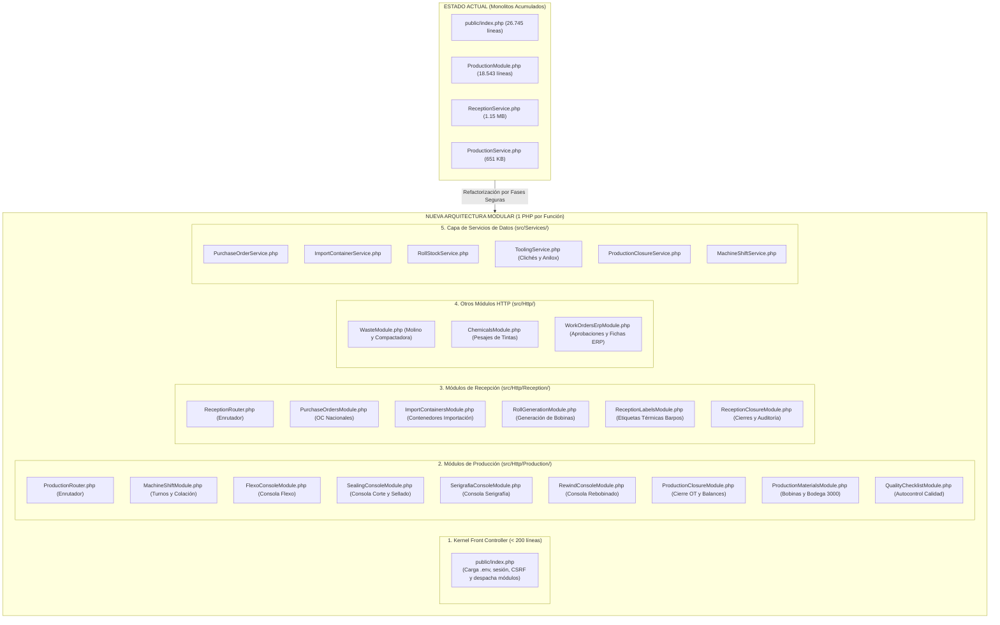
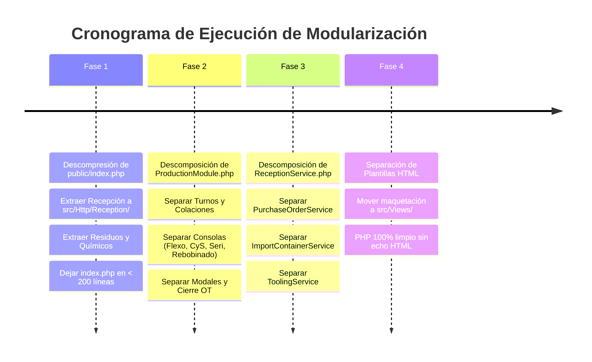

# PLAN MAESTRO DE MODULARIZACIÓN Y SEPARACIÓN DE ARCHIVOS PHP · UNIBAG ERP

> **Documento de Arquitectura y Refactorización**  
> **Fecha:** Octubre 2026  
> **Objetivo:** Descomponer los archivos monolíticos (`public/index.php`, `ProductionModule.php`, `ReceptionService.php` y `ProductionService.php`) en módulos PHP atómicos con una sola responsabilidad, facilitando la legibilidad, mantenimiento y escalabilidad sin interrumpir la operación continua de la planta.

---

## 1. Diagnóstico del Estado Actual (Monolitos Acumulados)

Actualmente el sistema cuenta con varios archivos de tamaño masivo ("God Files") que acumulan múltiples responsabilidades heterogéneas (consultas SQL, lógica de negocio, ruteo HTTP, maquetación HTML y scripts JavaScript):

| Archivo Actual | Tamaño / Líneas | Responsabilidades Mezcladas Actualmente |
| :--- | :--- | :--- |
| **`public/index.php`** | **26.745 líneas** (1.52 MB) | • Ruteo y renderizado de Recepción (Órdenes de Compra Nacionales y Contenedores de Importación).<br>• Ruteo y pantallas de Bonificaciones (Ayudantes, Flexo, CyS, Seri, exportadores XLS).<br>• Ruteo y operaciones de Residuos (Molino, Compactadora, Retiros, Inventarios).<br>• Ruteo y pantallas de Órdenes de Trabajo ERP (Setups, Aprobaciones VoBo, Cierres).<br>• Pesaje de tintas / químicos y miles de líneas de HTML/CSS concatenado en `echo`. |
| **`src/Http/ProductionModule.php`** | **18.543 líneas** (1.22 MB) | • Consolas de 5 tipos de máquina distintos (Flexografía, Corte y Sellado, Serigrafía Pulpo, Serigrafía Plana, Rebobinado) en un solo archivo.<br>• Gestión de turnos y asignación de máquinas.<br>• Modales de consumo de bobinas, asas, tintas y checklists de autocontrol de calidad.<br>• Cierre de producción con validación de supervisor y balance CC de 5 campos.<br>• Solicitudes de insumos y Bodega 3000.<br>• Layout visual y estilos embebidos. |
| **`src/ReceptionService.php`** | **1.15 MB** (+10.000 líneas) | • Órdenes de compra nacionales.<br>• Contenedores internacionales y packing list.<br>• Generación de bobinas e impresión de etiquetas térmicas.<br>• Catálogo y asignación de Clichés y Anilox.<br>• Consultas de órdenes de trabajo, setups, residuos y sincronización con el ERP. |
| **`src/ProductionService.php`** | **651 KB** (+12.000 líneas) | • Turnos de máquinas y pausas de colación.<br>• Consumos de bobinas, cálculo de mermas y balances.<br>• Continuidad de bobinas, eventos y registros de trazabilidad. |

---

## 2. Diagrama de Transición de Arquitectura



---

## 3. Estructura de Directorios y Archivos Propuesta

A continuación se detalla la ruta exacta, el nombre y la responsabilidad de cada nuevo archivo PHP:

```text
unibag-proyecto/
├── public/
│   └── index.php                               <-- Front Controller limpio (< 200 líneas)
│
├── src/
│   ├── Http/
│   │   ├── Production/                         <-- ÁREA DE PRODUCCIÓN Y PLANTA
│   │   │   ├── ProductionRouter.php            <-- Despachador de rutas /production/*
│   │   │   ├── MachineShiftModule.php          <-- Asignación de máquina, inicio/fin turno, colación
│   │   │   ├── WorkOrderLifecycleModule.php    <-- Iniciar nueva OT, OTs activas, historial
│   │   │   ├── FlexoConsoleModule.php          <-- Consola operativa de Flexografía
│   │   │   ├── SealingConsoleModule.php        <-- Consola operativa de Corte y Sellado
│   │   │   ├── SerigrafiaConsoleModule.php     <-- Consola operativa de Serigrafía (Pulpo y Plana)
│   │   │   ├── RewindConsoleModule.php         <-- Consola operativa de Rebobinadora
│   │   │   ├── ProductionMaterialsModule.php   <-- Montaje y consumo de bobinas, asas, Bodega 3000
│   │   │   ├── QualityChecklistModule.php      <-- Checklist de autocontrol de calidad por máquina
│   │   │   └── ProductionClosureModule.php     <-- Cierre de orden, clave supervisor, balance 5 campos
│   │   │
│   │   ├── Reception/                          <-- ÁREA DE RECEPCIÓN Y BODEGA MATERIA PRIMA
│   │   │   ├── ReceptionRouter.php             <-- Despachador de rutas /reception, /purchase-orders, etc.
│   │   │   ├── PurchaseOrdersModule.php        <-- Listado, detalle y recepción de OC Nacionales
│   │   │   ├── ImportContainersModule.php      <-- Listado, contenedores internacionales y aduana
│   │   │   ├── RollGenerationModule.php        <-- Pesaje balanza y generación física de bobinas
│   │   │   ├── ReceptionLabelsModule.php       <-- Impresión térmica Barpos y generación SVG
│   │   │   └── ReceptionClosureModule.php      <-- Cierre formal de recepción y auditoría
│   │   │
│   │   ├── Waste/                              <-- GESTIÓN DE RESIDUOS Y MERMAS
│   │   │   ├── WasteManagementModule.php       <-- Panel central de residuos, inventario y retiros
│   │   │   ├── WasteMolinoModule.php           <-- Operaciones y pesaje de molino
│   │   │   └── WasteCompactadoraModule.php     <-- Operaciones y pesaje de compactadora
│   │   │
│   │   ├── WorkOrders/                         <-- ÓRDENES DE TRABAJO EN ERP
│   │   │   ├── WorkOrderErpModule.php          <-- Listado de OTs, filtros y fichas técnicas
│   │   │   ├── SetupApprovalModule.php         <-- Pantallas y lógica de VoBo de setup inicial
│   │   │   └── AniloxClicheAssignModule.php    <-- Asignación de clisés y slots anilox a la OT
│   │   │
│   │   ├── Chemicals/                          <-- QUÍMICOS E INSUMOS
│   │   │   └── InksWeighingModule.php          <-- Registro, consumo y pesajes de tintas
│   │   │
│   │   └── (Módulos ya existentes: Auth, Inventario, Reportes, Bonificaciones)
│   │
│   ├── Services/                               <-- LÓGICA DE NEGOCIO Y ACCESO A DATOS (SQL)
│   │   ├── Reception/
│   │   │   ├── PurchaseOrderService.php        <-- Consultas y actualizaciones de OC nacionales
│   │   │   ├── ImportContainerService.php      <-- Consultas y cálculos de contenedores
│   │   │   ├── RollStockService.php            <-- Movimientos de stock, trazabilidad de bobinas
│   │   │   └── ToolingService.php              <-- Mantenedor de clichés, anilox y matrices
│   │   │
│   │   └── Production/
│   │       ├── MachineShiftService.php         <-- Consultas de sesiones de máquinas y operadores
│   │       ├── ProductionClosureService.php    <-- Cálculos de balance CC, mermas de arranque y fin
│   │       └── WasteService.php                <-- Base de datos para molino y compactadora
│   │
│   └── Views/                                  <-- PLANTILLAS HTML LIMPIAS (CERO SQL)
│       ├── layouts/                            <-- Layout de Producción y Layout de ERP
│       ├── production/                         <-- Fichas operativas, consolas y modales
│       └── reception/                          <-- Tablas de OC, contenedores y modales de cierre
```

---

## 4. Detalle de Responsabilidad por Cada Archivo

### 4.1. Módulos de Producción (`src/Http/Production/`)

1. **`ProductionRouter.php`**
   - **Qué hace:** Recibe el request `/production/*`, verifica la autenticación y despacha al submódulo correspondiente. Contiene las redirecciones de compatibilidad para `prodwrk.php`.
   - **Líneas estimadas:** ~120 líneas.

2. **`MachineShiftModule.php`**
   - **Qué hace:** Maneja la pantalla `/production/machines`, la apertura y cierre de turno del operario, cambio a modo colación (`/lunch`) y estado standby.
   - **Líneas estimadas:** ~250 líneas.

3. **`WorkOrderLifecycleModule.php`**
   - **Qué hace:** Maneja la selección e inicio de nueva OT (`/production/work-orders/new`), listado de OTs en curso (`/active`) e historial de la máquina (`/history`).
   - **Líneas estimadas:** ~300 líneas.

4. **`FlexoConsoleModule.php`**
   - **Qué hace:** Renderiza la consola de la máquina de Flexografía (ficha técnica, tintas Pantone, metros requeridos, avance de tiraje, clisés montados y slots anilox).
   - **Líneas estimadas:** ~500 líneas.

5. **`SealingConsoleModule.php`**
   - **Qué hace:** Renderiza la consola de Corte y Sellado (medidas de bolsa, fuelle, contador de unidades, generación de cajas y pallets terminados).
   - **Líneas estimadas:** ~550 líneas.

6. **`SerigrafiaConsoleModule.php`**
   - **Qué hace:** Renderiza las consolas de Serigrafía Pulpo y Plana (mallas, tintas al agua/plastisol, colores y pasadas).
   - **Líneas estimadas:** ~400 líneas.

7. **`RewindConsoleModule.php`**
   - **Qué hace:** Renderiza la consola de Rebobinadora (control de metros lineales, tensión, empalmes y bobinas resultantes).
   - **Líneas estimadas:** ~350 líneas.

8. **`ProductionMaterialsModule.php`**
   - **Qué hace:** Procesa el montaje de bobinas (`/materials/mount`), consumo de bobina madre (`/materials/consume`), gestión de asas (`/handles/manage`) y solicitudes a Bodega 3000.
   - **Líneas estimadas:** ~450 líneas.

9. **`QualityChecklistModule.php`**
   - **Qué hace:** Renderiza y procesa los formularios de autocontrol de calidad en máquina (aspecto, sellado, ancho, fuelle, adherencia de tinta).
   - **Líneas estimadas:** ~300 líneas.

10. **`ProductionClosureModule.php`**
    - **Qué hace:** Procesa el modal y cierre de orden con validación estricta de credenciales de supervisor (rol 31/admin), calcula y almacena los 5 campos del balance CC (Total CC, Producido, Acumulado previo, Total actualizado y Saldo por producir).
    - **Líneas estimadas:** ~450 líneas.

---

### 4.2. Módulos de Recepción (`src/Http/Reception/`)

1. **`ReceptionRouter.php`**
   - **Qué hace:** Enruta las peticiones de `/reception`, `/purchase-orders`, `/import-containers` hacia los controladores especializados.
   - **Líneas estimadas:** ~90 líneas.

2. **`PurchaseOrdersModule.php`**
   - **Qué hace:** Listado con filtros (activos, proveedor nacional, pendientes), detalle de líneas de orden de compra y exportación a Excel.
   - **Líneas estimadas:** ~450 líneas.

3. **`ImportContainersModule.php`**
   - **Qué hace:** Listado de contenedores marítimos, estado de aduana, desglose de ítems importados y exportación a Excel.
   - **Líneas estimadas:** ~450 líneas.

4. **`RollGenerationModule.php`**
   - **Qué hace:** Captura del pesaje de balanza, cálculo de metros teóricos por gramaje/ancho y generación del registro de bobina en la tabla de trazabilidad.
   - **Líneas estimadas:** ~350 líneas.

5. **`ReceptionLabelsModule.php`**
   - **Qué hace:** Generación de etiquetas con códigos de barras (Code-128 / Code-39) y emisión de comandos directos para impresoras térmicas Barpos.
   - **Líneas estimadas:** ~250 líneas.

6. **`ReceptionClosureModule.php`**
   - **Qué hace:** Modal y proceso de cierre formal de una recepción con justificación de diferencias entre lo pedido y lo recibido.
   - **Líneas estimadas:** ~280 líneas.

---

### 4.3. Módulos de Residuos, OTs ERP y Químicos (`src/Http/`)

1. **`src/Http/Waste/WasteManagementModule.php`**
   - **Qué hace:** Panel central de mermas, inventario de scrap, retiros y venta de material.
2. **`src/Http/Waste/WasteMolinoModule.php`**
   - **Qué hace:** Registro de mermas enviadas a molienda y pesajes.
3. **`src/Http/Waste/WasteCompactadoraModule.php`**
   - **Qué hace:** Registro de fardos compactados y pesajes de scrap.
4. **`src/Http/WorkOrders/WorkOrderErpModule.php`**
   - **Qué hace:** Vistas administrativas de órdenes de trabajo en ERP (fichas técnicas completas y aprobaciones de inicio/cierre).
5. **`src/Http/Chemicals/InksWeighingModule.php`**
   - **Qué hace:** Registro de pesaje de tintas por color y fórmulas químicas.

---

## 5. El Nuevo `public/index.php` (Front Controller Limpio)

Una vez extraídas todas las pantallas, el archivo `public/index.php` pasará de **26.745 líneas a menos de 200 líneas**, funcionando únicamente como el "Kernel" HTTP de la aplicación:

```php
<?php

declare(strict_types=1);

// 1. Carga de entorno y configuración
require_once __DIR__ . '/../src/Env.php';
require_once __DIR__ . '/../src/Db.php';
Env::load(__DIR__ . '/../.env');

// 2. Sesión, Zona Horaria y CSRF
date_default_timezone_set(Env::get('APP_TIMEZONE', 'America/Santiago'));
session_start();
csrfToken();

// 3. Captura de ruta y método
$path = parse_url($_SERVER['REQUEST_URI'] ?? '/', PHP_URL_PATH);
$method = strtoupper($_SERVER['REQUEST_METHOD'] ?? 'GET');

// 4. Conexiones a Base de Datos
$trzPdo = Db::pdo();
$erpPdo = Db::erpPdo();

// 5. Carga de Servicios
$prodService = new ProductionService($trzPdo, $erpPdo);
$receptionService = new ReceptionService($trzPdo, $erpPdo);
$scaleService = new ScaleService();

// 6. Enrutamiento Modular (Despacho a cada PHP especializado)
if (handleAuthRoutes($path, $method, $erpPdo)) exit;
if (handleApiRoutes($path, $method, $receptionService)) exit;

// Despacho a Producción
if (str_starts_with($path, '/production') || $path === '/prodwrk.php') {
    require_once __DIR__ . '/../src/Http/Production/ProductionRouter.php';
    if (handleProductionRouter($path, $method, $prodService, $receptionService, $scaleService)) exit;
}

// Despacho a Recepción
if (str_starts_with($path, '/reception') || str_starts_with($path, '/purchase-orders') || str_starts_with($path, '/import-containers')) {
    require_once __DIR__ . '/../src/Http/Reception/ReceptionRouter.php';
    if (handleReceptionRouter($path, $method, $receptionService, $scaleService)) exit;
}

// Despacho a Residuos
if (str_starts_with($path, '/waste')) {
    require_once __DIR__ . '/../src/Http/Waste/WasteManagementModule.php';
    if (handleWasteRoutes($path, $method, $prodService, $receptionService)) exit;
}

// Despacho a Inventario, Reportes, Bodegas y Bonificaciones
if (handleInventoryRoutes($path, $method, $receptionService)) exit;
if (handleErpReportRoutes($path, $method, $receptionService)) exit;
if (handleWarehousesRoutes($path, $method, $receptionService)) exit;
if (handleBonusesRoutes($path, $method, $erpPdo)) exit;

// 7. Ruta por defecto / 404
renderNotFoundResponse();
```

---

## 6. Hoja de Ruta de Ejecución por Etapas (Sin Detener la Planta)

Para garantizar la estabilidad operacional de la fábrica durante los cambios, la refactorización se ejecutará en 4 fases sucesivas:



### Detalle de las Fases:

#### **Fase 1: Descompresión de `public/index.php`**
- **Paso 1.1:** Crear la carpeta `src/Http/Reception/` y migrar las rutas `/purchase-orders` e `/import-containers` con sus funciones de ayuda.
- **Paso 1.2:** Crear la carpeta `src/Http/Waste/` y migrar `/waste/management`, `/waste/molino`, `/waste/compactadora`.
- **Paso 1.3:** Migrar las rutas pendientes de Bonificaciones y Químicos (`/chemicals`).
- **Paso 1.4:** Reducir `public/index.php` al Front Controller limpio.
- **Verificación:** Probar que la navegación de recepción, mermas y bonificaciones responde exactamente igual.

#### **Fase 2: Descomposición de `ProductionModule.php`**
- **Paso 2.1:** Crear `src/Http/Production/` y el router `ProductionRouter.php`.
- **Paso 2.2:** Extraer `MachineShiftModule.php` (turnos y colaciones).
- **Paso 2.3:** Extraer las 4 consolas principales (`FlexoConsoleModule.php`, `SealingConsoleModule.php`, `SerigrafiaConsoleModule.php`, `RewindConsoleModule.php`).
- **Paso 2.4:** Extraer `ProductionClosureModule.php` (cierre de orden y balance de 5 campos).
- **Paso 2.5:** Extraer `ProductionMaterialsModule.php` (montaje de bobinas y Bodega 3000).
- **Verificación:** Probar que las consolas de operador de cada máquina cargan sin errores y los pesajes de balanza siguen funcionando.

#### **Fase 3: Descomposición de `ReceptionService.php`**
- **Paso 3.1:** Crear `src/Services/Reception/PurchaseOrderService.php` y mover métodos de órdenes de compra.
- **Paso 3.2:** Crear `src/Services/Reception/ImportContainerService.php` y mover métodos de contenedores.
- **Paso 3.3:** Crear `src/Services/Reception/ToolingService.php` para clichés y anilox.
- **Paso 3.4:** Mantener `ReceptionService.php` como puente heredado para que ninguna llamada externa se rompa.

#### **Fase 4: Separación de Vistas y Plantillas HTML**
- **Paso 4.1:** Crear la estructura de vistas en `src/Views/`.
- **Paso 4.2:** Reemplazar funciones que concatenan miles de líneas de HTML por llamadas directas a plantillas (`renderView('production/flexo-console', $data)`).

---

## 7. Reglas de Oro para la Refactorización

1. **Cero Rompimiento de URLs:** Todas las rutas públicas (`/production/work-orders/operate`, `/purchase-orders`, `/waste/molino`, etc.) deben mantener exactamente la misma firma y parámetros para no romper enlaces guardados en terminales ni scripts de planta.
2. **Preservar la Lógica de Hardware:** Los endpoints de balanza (`/api/scale/weight`) y los comandos de impresión térmica de etiquetas deben mantenerse intactos.
3. **Mantenimiento de Sesiones y Permisos:** Cada módulo nuevo debe seguir validando los roles de usuario y las áreas de sesión (`ERP`, `RECEPTION`, `PRODUCTION`, `SCALE`).
4. **Verificación Paso a Paso:** Cada módulo extraído se prueba inmediatamente antes de proceder con el siguiente.
